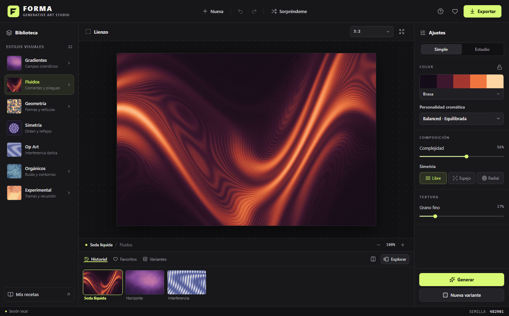

# FORMA — Generative Art Studio

FORMA creates and exports reproducible abstract art locally. The desktop launcher and WebAssembly seed routine use **Rust**. The interface and rendering engine use **TypeScript, React, GLSL, WebGL2**, and a **Canvas 2D** fallback.

[Descargas y guía en español](README.md) · [Release v1.1.0-preview.2](https://github.com/danieliiisimo22-bit/FORMA/releases/tag/v1.1.0-preview.2) · [MIT license](LICENSE)

## Run the desktop preview

Download the ZIP for Windows x64, macOS 13+ (Apple Silicon or Intel), or Linux x64. The combined ZIP includes all four builds. Extract it and launch `forma.exe` on Windows or run `./forma` in a terminal on macOS or Linux. If extraction drops Unix permissions, run `chmod +x forma`. Keep the terminal open while using the studio at `http://127.0.0.1:56144/`. The macOS preview is available without Apple notarization. [Desktop guide](docs/desktop.md)

## Create and export

Choose a style in **Biblioteca**, adjust color and composition in **Simple**, or open **Estudio** for algorithm-specific settings. FORMA includes 22 procedural generators, 36 curated palettes, deterministic seeds, protected colors and parameters, and side-by-side comparison. The new styles are **Cintas de luz**, **Nácar**, **Difusión de color**, and **Relieve espectral**. [Gallery of 110 compositions](docs/validacion/galeria.png) · [Generator catalog](docs/generators.md)

Export PNG, JPEG, or WebP in 8-bit sRGB, or export the editable recipe as JSON. Custom image sizes reach 8192 pixels per side and 34 megapixels, subject to browser memory. Use **Mis recetas** to transfer collections of presets, favorites, and palettes between browsers or computers.

## Build and test

With Node.js 22.12 or newer, run `npm ci` and `npm run dev`. For the desktop build, also install stable Rust and run `rustup target add wasm32-unknown-unknown` and `npm run build:desktop`. The binary is written to `target/release/`.

Run `npm test` for unit tests, then `npx playwright install chromium` and `npm run test:e2e` for browser tests. `npm run test:gallery` generates the documented artwork samples and metrics. [Architecture](docs/architecture.md) · [Validation](docs/validation.md) · [Roadmap](docs/roadmap.md)

Released under the MIT license. The ZIP packages include third-party notices. [License](LICENSE) · [Notices](public/third-party-licenses.txt)
