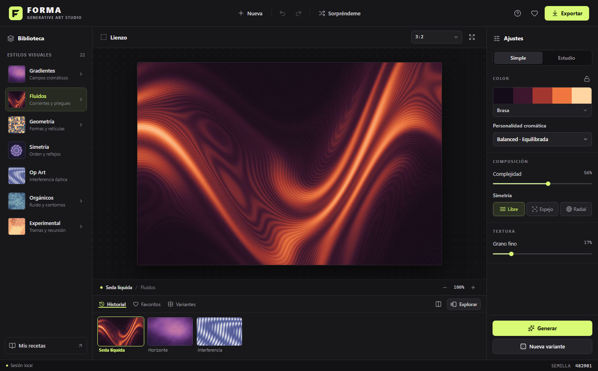
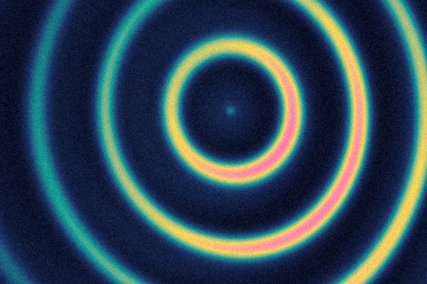

<p align="center"></p>

# FORMA — Generative Art Studio

Estudio de arte abstracto procedural para crear fondos y composiciones reproducibles. Genera, edita y exporta localmente, con controles sencillos y un modo Estudio para ajustar cada algoritmo. **Rust** ejecuta el lanzador de escritorio y la rutina de semillas por WebAssembly. **TypeScript, React y GLSL** componen la interfaz y el motor gráfico.

[Descargas](https://github.com/danieliiisimo22-bit/FORMA/releases/tag/v1.1.0-preview.2) · [English README](README.en.md) · [Roadmap](docs/roadmap.md) · [Licencia MIT](LICENSE)



## Descargar y abrir

La versión **1.1.0-preview.2** ofrece cuatro ejecutables portables. Usa el ZIP de tu plataforma o **Todos-los-sistemas.zip** para obtenerlos juntos. Requiere un navegador moderno. Una vez extraído, funciona localmente sin instalar Node.js o Rust y sin conexión a Internet.

| Sistema | Paquete | Inicio |
| --- | --- | --- |
| Windows 64 bits | `Windows-x64.zip` | Abre `Iniciar FORMA.cmd` o `forma.exe`. |
| macOS 13+ · serie M | `macOS-Apple-Silicon.zip` | Abre Terminal en la carpeta y ejecuta `./forma`. |
| macOS 13+ · Intel | `macOS-Intel.zip` | Abre Terminal en la carpeta y ejecuta `./forma`. |
| Linux 64 bits · Intel/AMD | `Linux-x64.zip` | Abre una terminal en la carpeta y ejecuta `./forma`. |

El estudio se abre en `http://127.0.0.1:56144/`. Mantén la terminal abierta y usa `Ctrl+C` para salir. En macOS y Linux, si tu extractor omite los permisos, ejecuta `chmod +x forma`. Los binarios de macOS son de vista previa y carecen de notarización de Apple. [Guía de escritorio](docs/desktop.md)

## Galería

Estas muestras se renderizaron en FORMA con las recetas incluidas en **Biblioteca**. Los cuatro estilos se inspiran en pliegues de luz, superficies nacaradas, gradientes granulados y crestas espectrales.

| Cintas de luz · Fluidos | Nácar · Fluidos |
| --- | --- |
|  |  |
| **Difusión de color · Gradientes** | **Relieve espectral · Fluidos** |
|  |  |

[Galería de 110 composiciones](docs/validacion/galeria.png) · [Catálogo de 22 generadores](docs/generators.md)

## Crear una composición

1. Abre el desplegable de una familia en **Biblioteca** y elige un estilo. En **Simple**, ajusta color, complejidad, simetría y textura. **Estudio** muestra los parámetros de cada generador.
2. Usa **Generar** para cambiar la semilla, **Nueva variante** para mover también los parámetros o **Sorpréndeme** para cambiar de familia. **Mutar composición** crea 4, 9 o 16 descendientes y **Comparar composiciones** muestra dos resultados en paralelo.
3. Guarda con el corazón o usa **Mis recetas** para conservar un preset con nombre. Exporta la obra como PNG, JPEG o WebP, o guarda la receta y su semilla en JSON para volver a editarla.

FORMA incluye 36 paletas, edición HEX, extracción de color y bloqueos individuales. Conserva la última sesión, hasta tres composiciones recientes y tus colecciones en el almacenamiento del navegador. Usa **Mis recetas → Exportar biblioteca** para trasladarlas a otro equipo. El tamaño máximo personalizado es de 8192 píxeles por lado y 34 megapíxeles, sujeto a la memoria disponible. Las imágenes se renderizan a tamaño final en sRGB de 8 bits por canal.

## Compilar desde el código

Requiere Node.js 22.12 o posterior, npm y un navegador actual. La compilación de escritorio añade Rust estable, el target WebAssembly y el compilador del sistema.

```sh
npm ci
npm run dev
```

El siguiente comando genera el ejecutable de tu sistema.

```sh
rustup target add wasm32-unknown-unknown
npm run build:desktop
```

El ejecutable queda en `target/release/`. Para construir el sitio estático, usa `npm run build`. Sirve `dist/` por HTTP para habilitar el worker de exportación. [Arquitectura](docs/architecture.md) · [Compilación por plataforma](docs/desktop.md)

## Pruebas y contribuciones

Ejecuta `npm test` para las pruebas del motor. Con `npx playwright install chromium` y `npm run test:e2e` puedes probar la interfaz, las bibliotecas y la exportación. `npm run test:gallery` genera las muestras y métricas. Para añadir estilos, usa la guía de generadores y conserva la compatibilidad de las recetas ya guardadas. [Validación](docs/validation.md) · [Guía de generadores](docs/generators.md)

## Licencia

Código bajo licencia MIT. Los avisos de terceros se incluyen en cada paquete. [Texto de la licencia](LICENSE) · [Avisos de la interfaz](public/third-party-licenses.txt) · [Avisos de escritorio](docs/licenses/desktop.txt)
