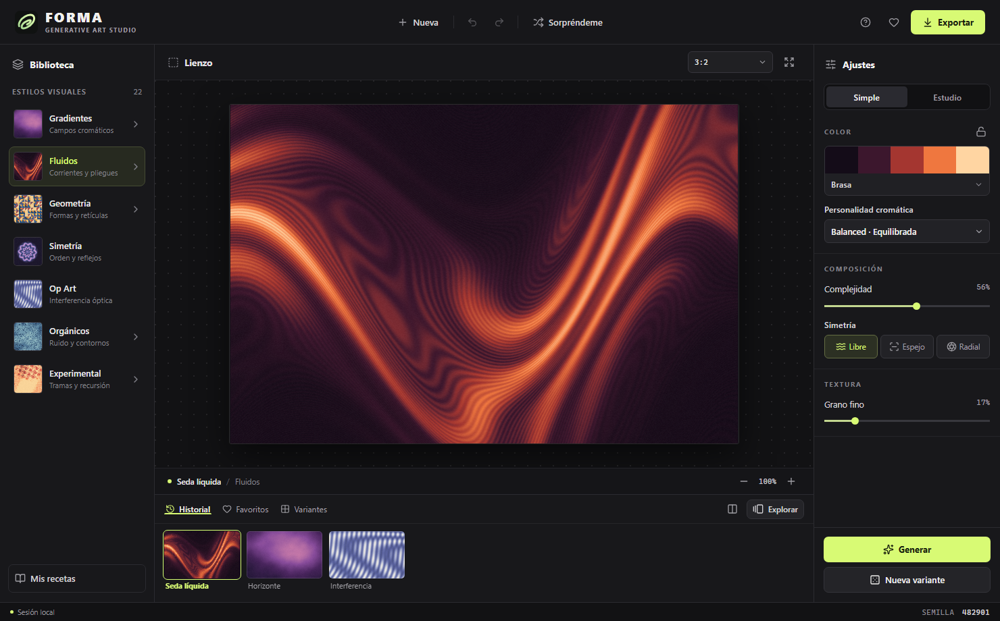
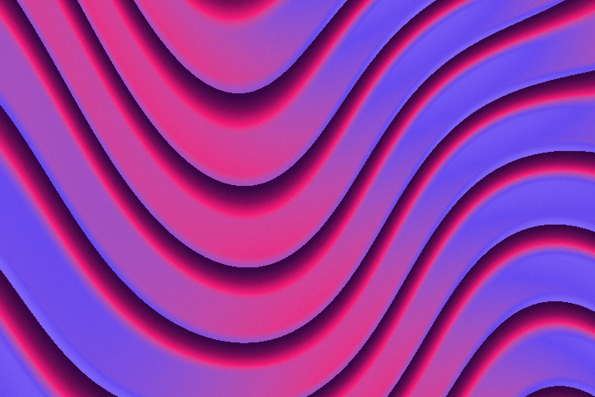
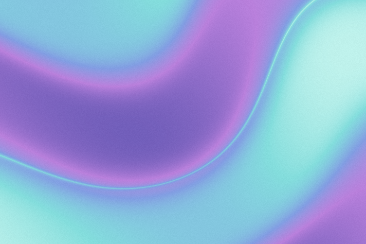
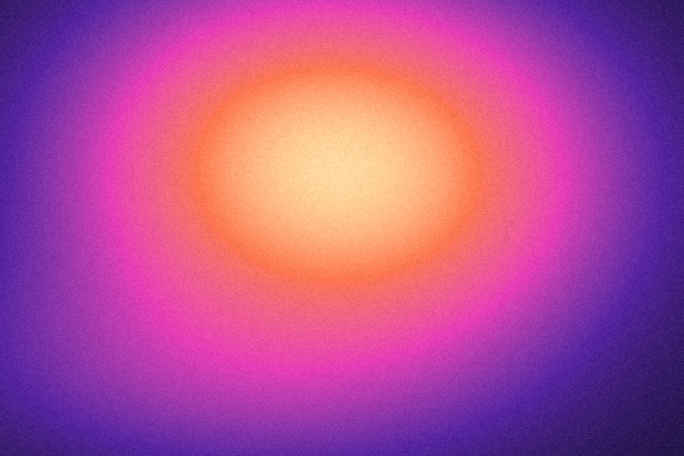

<p align="center"></p>

# FORMA — Generative Art Studio

Estudio local para crear fondos y arte abstracto procedural. **Rust** implementa la interfaz, los 22 generadores, las paletas, la biblioteca y la exportación. El navegador ejecuta el estudio como **WebAssembly** y dibuja con **WebGL2 y GLSL**, con respaldo Canvas 2D. El lanzador Rust incorpora todos los recursos.

[Descargas](https://github.com/danieliiisimo22-bit/FORMA/releases/tag/v1.2.0-preview.2) · [English README](README.en.md) · [Licencia MIT](LICENSE)



## Descargar y abrir

Descomprime el ZIP de tu plataforma. La descarga combinada incluye los cuatro ejecutables. El estudio abre el navegador y funciona localmente después de extraerlo.

| Sistema | Paquete | Inicio |
| --- | --- | --- |
| Windows x64 | `Windows-x64.zip` | Abre `Iniciar FORMA.cmd` o `forma.exe`. |
| macOS 13+ Apple Silicon | `macOS-Apple-Silicon.zip` | Ejecuta `./forma` en Terminal. |
| macOS 13+ Intel | `macOS-Intel.zip` | Ejecuta `./forma` en Terminal. |
| Linux x64 | `Linux-x64.zip` | Ejecuta `./forma` en una terminal. |

El navegador se conecta a `http://127.0.0.1:56144/`. Mantén la terminal abierta y usa `Ctrl+C` para salir. [Arranque y verificación de los ZIP](docs/desktop.md)

## Crear una composición

Elige un estilo en **Biblioteca**. Ajusta la paleta, el encuadre y los parámetros en **Simple** o **Estudio**. Cambia la semilla con **Generar**, o explora combinaciones con **Nueva variante**, **Mutar composición** y **Comparar composiciones**.

FORMA incluye 36 paletas, edición HEX, extracción de color y bloqueos individuales. La sesión, los favoritos y las recetas se guardan en el navegador. Usa **Mis recetas → Exportar biblioteca** para guardar una copia en JSON.

Exporta imágenes sRGB en PNG, JPEG o WebP con tamaños de hasta 8192 píxeles por lado y 34 megapíxeles, según la memoria del equipo.

| Cintas de luz | Nácar |
| --- | --- |
|  |  |
| **Difusión de color** | **Relieve espectral** |
|  |  |

[Galería de 110 composiciones](docs/validacion/galeria.png) · [Catálogo de generadores](docs/generators.md)

## Compilar y comprobar

Usa Rust estable y el compilador nativo de tu sistema. El directorio generado para publicar el estudio como sitio estático es `target/forma-web/`.

```sh
rustup target add wasm32-unknown-unknown
cargo install wasm-bindgen-cli --locked --version 0.2.130
cargo test --locked -p forma-core
cargo run --locked -p forma-build -- desktop
```

El ejecutable queda en `target/release/`. Para pruebas de navegador instala Node.js 22.12 o posterior y ejecuta `npm ci`, `npx playwright install chromium` y `npm run test:e2e`. [Arquitectura](docs/architecture.md) · [Validación](docs/validation.md) · [Compilación y empaquetado](docs/desktop.md)

## Licencia

Código bajo licencia MIT. Cada paquete incluye los avisos de terceros. [Licencia](LICENSE) · [Iconos](public/third-party-licenses.txt) · [Dependencias Rust](docs/licenses/desktop.txt)
