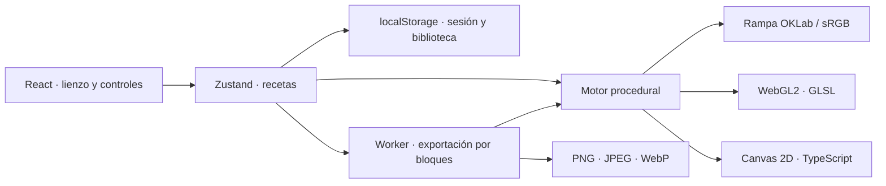

# Arquitectura

## Flujo de datos

| Módulo | Responsabilidad |
| --- | --- |
| `src/engine` | Semillas, coordenadas, simetría, selección de backend y acabado de referencia en CPU |
| `src/generators` | Registro de campos procedurales y metadatos |
| `src/palettes` | Armonías, conversión OKLab / OKLCH, mapeo de gamut, extracción cromática |
| `src/shaders` | Composición geométrica, evaluación de campos, color y acabado en GPU |
| `src/presets` | Recetas iniciales, validación, proporciones, variantes y mutaciones |
| `src/state` | Historial acotado, deshacer, rehacer, favoritos y persistencia |
| `src/export`, `src/workers` | Renderizado por bloques, cancelación, codificación y descargas |
| `src/components` | Biblioteca visual, canvas, controles modales y detallados |
| `tests` | Pruebas de motor, interfaz, descarga, pérdida de contexto y galería |

## Reproducibilidad y composición

`schema` versiona el formato del documento. `algorithm` corresponde a la versión declarada por el generador. El importador comprueba estos dos campos, el ID de generador, los rangos y las opciones compatibles antes de aplicar una receta. Cada receta contiene cuatro parámetros del generador, el grado de complejidad, cinco colores, la armonía, la personalidad, los bloqueos, el modo de simetría y sus parámetros, la textura, la proporción y las opciones de render.

A partir de la semilla de 32 bits, Mulberry32 deriva fase, escala, rotación y desplazamiento de la composición. Cada campo define sus propias masas y frecuencias. Las acciones guiadas usan las envolventes y los rangos seguros del campo. Las simetrías pliegan las coordenadas alrededor de un eje o sector antes de evaluar el campo. Los acabados y el dithering operan como una etapa posterior. El grano técnico usa las coordenadas absolutas del píxel, de modo que una tesela se alinea con el render completo.

Misma receta, dimensiones y entorno de render producen el mismo resultado. GPU y CPU usan las mismas fórmulas y rampa, aunque difieren en precisión aritmética, evaluación trigonométrica y redondeo. Las fronteras de celdas y los detalles de alta frecuencia son sensibles a esas diferencias. Los codificadores JPEG y WebP también pueden producir bytes distintos entre navegadores. La garantía de determinismo se refiere al render en el mismo backend y entorno, con idénticas dimensiones.

## Color y acabado

Las armonías eligen un tono dominante a partir de la paleta de partida, con desviaciones de tono, brillo y croma determinadas por el perfil y la semilla. El mapeo a sRGB reduce croma con una búsqueda binaria manteniendo tono y luminosidad. La rampa de 512 entradas interpola en OKLab. La extracción estima cinco colores mediante cuantiles de luminosidad perceptual en una muestra del lienzo. El grano estético y el dithering de cuantización pueden ajustarse por separado. El halo y el desenfoque aproximan vecindades mediante muestras analíticas del campo.

## Vista previa, exportación y memoria

La vista previa usa un renderer compartido entre lienzo y miniaturas, con caché de programas GLSL por generador y de rampas cromáticas. La resolución interna baja durante arrastres y aumenta tras la pausa. Las miniaturas se dibujan al entrar en el área visible, en grupos pequeños por fotograma. Si se pierde el contexto se renderiza mediante Canvas 2D. Al restaurarse, WebGL2 recompila los programas necesarios.

La exportación usa un worker con `OffscreenCanvas` cuando está disponible y cede el hilo entre bloques en la ruta alternativa. Se evalúan coordenadas globales en cada bloque, incluyendo tintas y efectos que consultan píxeles vecinos. El worker puede terminarse inmediatamente con Cancelar. El ensamblaje requiere un canvas 2D a la resolución final y hasta unos 136 MB de píxeles RGBA en el máximo de 34 MP, más copias del navegador y el codificador. El límite real depende del navegador. Si el backend cambia después de copiar el primer bloque, la exportación informa del error para evitar mezclar los dos renderizadores en el mismo archivo.

## Persistencia

Los controles editan un borrador durante arrastres. Al terminar se guarda un paso de deshacer y una entrada visual, con un máximo de 36. La última receta, la biblioteca y el modo se almacenan como JSON en el mismo origen. El historial de deshacer y rehacer se reinicia al recargar. Los archivos de biblioteca se validan por completo antes de actualizar el estado. Las miniaturas se vuelven a generar desde las recetas. La primera sesión incluye cinco muestras de la biblioteca en el historial para poder comparar o abrir un estilo de inmediato.
